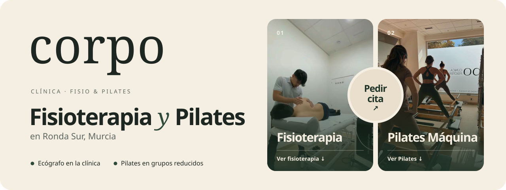
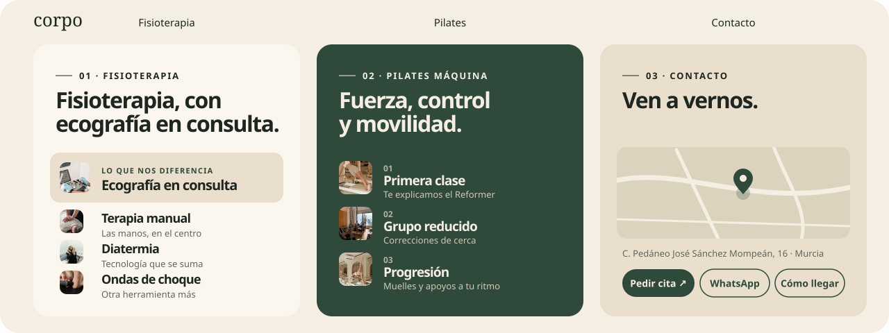
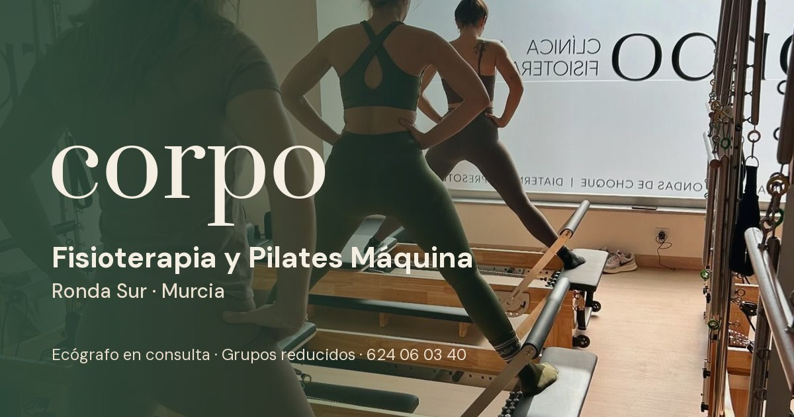

<div align="center">



<br>


**una página · tres pantallas · un sello para pedir cita**<br>
la web de Clínica Corpo, fisioterapia y Pilates Máquina en Ronda Sur, Murcia.

[qué es](#qué-es) ·
[cómo se recorre](#cómo-se-recorre) ·
[fotos y vídeos](#fotos-y-vídeos) ·
[seo local](#seo-local) ·
[decisiones técnicas](#decisiones-técnicas) ·
[arrancarlo](#arrancarlo)

</div>

<br>

## Qué es

Corpo es una clínica de barrio que hace dos cosas: **fisioterapia** (con ecógrafo en consulta)
y **Pilates Máquina** en grupos reducidos. La web tiene un único trabajo: que quien llega
entienda en segundos cuál de las dos busca, dónde está la clínica y cómo pedir cita.

Por eso no hay menús profundos ni páginas de relleno. Es una sola página con una portada
partida en dos, una pantalla por servicio y una de contacto. Cada pantalla mide exactamente
lo que la ventana bajo la barra de navegación.

> [!NOTE]
> La reserva se hace en la plataforma de la clínica
> ([appclinicacorpo.viday.es](https://appclinicacorpo.viday.es/)). Esta web no guarda datos de
> nadie: solo enlaza a la reserva, a WhatsApp, al teléfono y a Google Maps.

## Cómo se recorre



1. **Portada.** Dos mitades, fisioterapia y Pilates, cada una con su foto o vídeo y un enlace
   a su pantalla. En medio, el sello de **«Pedir cita»**, que es la acción principal de toda
   la web.
2. **Fisioterapia.** La ecografía va destacada porque es lo que diferencia a la clínica; debajo,
   terapia manual, diatermia, ondas de choque y presoterapia.
3. **Pilates Máquina.** Tres pasos (primera clase, grupo reducido, progresión) pensados para
   quien nunca ha subido a un Reformer.
4. **Contacto.** Mapa de OpenStreetMap con la clínica marcada, dirección, teléfono, email y
   tres botones: pedir cita, WhatsApp con el mensaje ya escrito y cómo llegar.

<table>
<tr>
<th width="33%">🧭 navegación</th>
<th width="33%">🎞️ movimiento</th>
<th width="33%">📱 móvil</th>
</tr>
<tr valign="top">
<td>

La barra marca la sección en la que estás y los enlaces internos se desplazan con suavidad.
Abrir `/#pilates` te lleva directamente a esa sección.

</td>
<td>

Las secciones aparecen con una entrada escalonada al llegar a ellas. Con
`prefers-reduced-motion` todo se muestra sin animación y el desplazamiento es instantáneo.

</td>
<td>

En la portada las dos mitades se superponen en diagonal, como dos fotos sobre la mesa. Las
pantallas pasan a una columna y los vídeos cargan solo sus metadatos hasta que hacen falta.

</td>
</tr>
</table>

## Fotos y vídeos

Las fotos y los vídeos salen sobre todo del Instagram de la clínica
([@clinicacorpomurcia](https://www.instagram.com/clinicacorpomurcia/)). Cada hueco de la página
tiene un nombre, y basta con dejar un archivo con ese nombre en `src/assets/instagram/` para
que la web lo use:

```
src/assets/instagram/
  hero-fisio.jpg     mitad de fisioterapia de la portada
  hero-pilates.jpg   mitad de Pilates de la portada
  fisio.mp4          vídeo de la pantalla de fisioterapia
  pilates.mp4        vídeo de la pantalla de Pilates
  ecografia.jpg      tarjeta destacada de ecografía
  pilates-1..3.jpg   fotos de los tres pasos de Pilates
  fisio-*.jpg        miniaturas de los servicios de fisioterapia
```

- Vale `.jpg`, `.png`, `.webp`, `.avif`, `.mp4` o `.webm`. Si hay foto y vídeo para el mismo
  hueco, **gana el vídeo**.
- Si falta un archivo, se usa una foto de reserva o un icono. La página nunca se queda con un
  hueco vacío.
- La procedencia de cada imagen (Instagram de Corpo o Unsplash, con su enlace) está en
  [`src/assets/instagram/LEEME.md`](src/assets/instagram/LEEME.md).

## SEO local



<sub>así se ve el enlace al compartirlo por WhatsApp o redes sociales</sub>

- **Ficha de negocio en JSON-LD** (`Physiotherapy` + `ExerciseGym`): dirección, coordenadas,
  teléfono, servicios, zona que atiende y la acción de reservar.
- **Open Graph y Twitter Card** con una imagen de 1200×630 hecha para la clínica.
- **`robots.txt` y `sitemap.xml` generados al compilar** por un pequeño plugin de Vite, con la
  URL real del sitio. En Netlify se toma sola de la variable `URL`; para forzar otra, define
  `SITE_URL`.
- **Contenido en `<noscript>`** con el nombre, los servicios, la dirección y el teléfono, para
  que quede algo legible aunque no se ejecute JavaScript.
- Iconos para todas las plataformas: `favicon.svg`, `.ico`, `apple-touch-icon` e iconos
  *maskable* del manifiesto.

## Decisiones técnicas

| Decisión | Por qué |
|---|---|
| **Una sola página** | Una clínica local necesita explicar dos servicios y dar una vía de contacto. Cada clic extra es alguien que no llega a pedir cita. |
| **Vite + React como SPA estática** | No hay datos que cambien ni nada que renderizar en servidor. Se compila a estáticos y Netlify los sirve; `_redirects` hace que cualquier ruta abierta directamente devuelva la web en lugar de un 404. |
| **CSS propio para la página** | `duo.css` lleva la paleta (verde, beige, crema) como variables y el diseño a pantalla completa con `100svh`, que con utilidades sería ilegible. |
| **Leaflet + OpenStreetMap** | Un mapa sin clave de API ni cookies de terceros. Se carga solo cuando la sección de contacto entra en pantalla. |
| **Medios por nombre de archivo** | `import.meta.glob` descubre los archivos de `src/assets/instagram/` al compilar. Cambiar una foto es sustituir un archivo, sin tocar código. |
| **Logotipo en SVG** | Reconstruido en vector a partir del perfil de Instagram, hereda el color del texto y se ve nítido a cualquier tamaño. |
| **Datos de la clínica en un solo sitio** | Dirección, teléfono, email y enlaces viven en `src/lib/corpo.ts`. Si cambia el teléfono, se cambia una vez. |

## Estructura

```
src/
  pages/Duo.tsx            la página: portada, fisioterapia, Pilates y contacto
  pages/duo.css            paleta, tipografía y maquetación a pantalla completa
  components/corpo/
    CorpoLogo.tsx          logotipo en SVG
    CorpoMap.tsx           mapa de Leaflet que se carga al verse
    CorpoMedia.tsx         foto o vídeo de un hueco, con reserva
  lib/corpo.ts             datos de contacto de la clínica
  lib/instagram-media.ts   descubre los medios de src/assets/instagram
  hooks/use-reveal.ts      entrada escalonada de las secciones
  assets/instagram/        fotos y vídeos de la página
public/                    iconos, manifiesto, imagen para compartir y _redirects
index.html                 metadatos, Open Graph y JSON-LD de la clínica
vite.config.ts             plugin de SEO: %SITE_URL%, robots.txt y sitemap.xml
PRODUCT.md                 propósito, público y compromisos de marca
```

## Arrancarlo

<details>
<summary><b>desarrollo local</b></summary>

Requisitos: Node.js y pnpm.

```bash
pnpm install
pnpm dev          # http://localhost:8080
```

</details>

<details>
<summary><b>compilar y comprobar</b></summary>

```bash
pnpm lint
pnpm test         # Vitest
pnpm build        # estáticos en dist/, con robots.txt y sitemap.xml
pnpm preview
```

</details>

<details>
<summary><b>despliegue</b></summary>

Netlify compila con `pnpm build` y publica `dist/`. La URL pública se toma de la variable
`URL` que pone Netlify; si el dominio definitivo es otro, define `SITE_URL` en las variables
de entorno del sitio para que el canonical, Open Graph, el JSON-LD y el sitemap apunten a él.

</details>

## Ilustraciones del README

Las dos ilustraciones de arriba se generan con las mismas fuentes, colores y fotos que la web:

```bash
pip install pillow
python docs/readme/generar.py .
```

---

<div align="center">
<br>
<sub>fisioterapia y Pilates Máquina · Ronda Sur, Murcia</sub>
</div>
